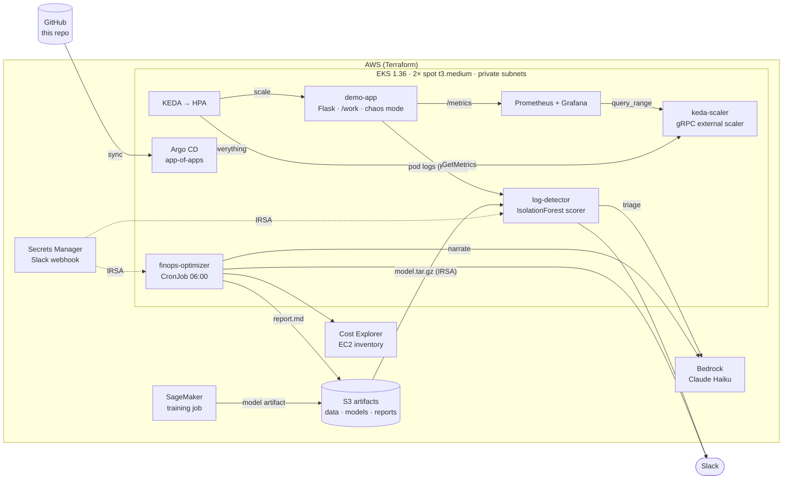

# AIOps Platform on Amazon EKS

[](https://github.com/Parker2127/aiops-platform/actions/workflows/ci.yml)

> **Built an AI log-anomaly detector, AI-driven KEDA autoscaling and a FinOps optimizer; shipped models via Argo CD GitOps.**
> Stack: EKS, Python, LLMs, KEDA, Argo CD, SageMaker.

This repo is the working implementation of that claim. Terraform builds the cluster, Argo CD deploys everything on it from Git, and three Python services do the "AI" part:

| Component | What it does | ML / AI piece |
|---|---|---|
| [**log-detector**](apps/log-detector) | Tails app logs in real time, flags anomalies, posts triaged Slack alerts | IsolationForest trained as a **SageMaker** job; **Bedrock (Claude Haiku)** triages each alert |
| [**keda-scaler**](apps/keda-scaler) | KEDA **external scaler** (gRPC) that scales on *forecast* load, not current load | EWMA + linear-trend forecaster over Prometheus request rate |
| [**finops-optimizer**](apps/finops-optimizer) | Daily CronJob: Cost Explorer spend, idle resources, K8s waste → report | **Bedrock** narrates the numbers; a guard flags any figure the LLM didn't get from the data |

## Architecture



**GitOps model delivery:** `ml/train_sagemaker.py --pin` writes the new model's S3 URI into
[`apps/log-detector/k8s/kustomization.yaml`](apps/log-detector/k8s/kustomization.yaml). That value
feeds a hash-suffixed ConfigMap, so committing it renames the ConfigMap. Argo CD then syncs and the
detector rolls onto the new model. **A model release is a reviewed git commit, and rolling back is `git revert`.**

## Stack

| Layer | Choice | Notes |
|---|---|---|
| IaC | Terraform ≥ 1.10, AWS provider 6.x | hand-written modules (`vpc`, `eks`, `irsa`); S3 state with native lockfile (no DynamoDB) |
| Cluster | EKS 1.36, managed node group | standard support only (`upgrade_policy`), access entries, VPC CNI prefix delegation (110 pods/node) |
| GitOps | Argo CD 3.6 app-of-apps | every workload is an `Application` in [`gitops/apps`](gitops/apps) |
| Platform | KEDA 2.21, kube-prometheus-stack 93 | Helm charts as Argo apps, server-side apply for CRDs |
| ML | scikit-learn 1.9 IsolationForest, SageMaker script mode | same version pinned for training and serving |
| LLM | Amazon Bedrock, `us.anthropic.claude-haiku-5-5`, Converse API | enrichment only; every path works with the LLM down |
| Apps | Python 3.12, Flask, FastAPI, grpcio, boto3 | multi-stage non-root images, read-only root FS |
| Auth | IRSA per workload | each role scoped to exactly what that service touches ([`infra/envs/dev`](infra/envs/dev)) |

## Quickstart

**Prereqs:** AWS CLI (account 818651034041 / us-east-1), Terraform ≥ 1.10, kubectl, Helm, Docker with buildx, [uv](https://docs.astral.sh/uv/).
You also need Bedrock model access for Anthropic models. That's a one-time use-case form in the Bedrock console.

```bash
# 0. one-time: state bucket
cd infra/bootstrap && terraform init && terraform apply && cd -

# 1. infrastructure (~15 min)
cd infra/envs/dev
cp terraform.tfvars.example terraform.tfvars   # lock the API endpoint to your IP
terraform init && terraform plan -out tfplan && terraform apply tfplan
aws eks update-kubeconfig --region us-east-1 --name aiops-dev
kubectl get nodes                               # 2× Ready, spot
cd -

# 2. Slack webhook (kept out of Terraform state)
aws secretsmanager put-secret-value --secret-id aiops/slack-webhook \
  --secret-string 'https://hooks.slack.com/services/XXX/YYY/ZZZ'

# 3. train the model on SageMaker and pin it
uv sync
uv run python ml/generate_logs.py
uv run python ml/train.py                       # local sanity check (~5 s)
uv run python ml/train_sagemaker.py --upload-data --wait --pin

# 4. images -> ECR, pin tags
./scripts/build-push.sh
git add -A && git commit -m "Pin images + model" && git push

# 5. hand the cluster to Argo CD
./scripts/deploy-argocd.sh
kubectl -n argocd get applications -w           # all Synced / Healthy
```

Then run the demos in **[DEMO.md](DEMO.md)**.

## What each part does

### 1. Log-anomaly detector: [`ml/`](ml) + [`apps/log-detector`](apps/log-detector)

- **Features** ([`ml/features.py`](ml/features.py)): 11 numeric features per JSON log line: level, HTTP status class, 5xx flag, log latency, message length, exception present, error-keyword count, digit and uppercase ratios, unknown route, non-JSON line. The **same file** is copied into the detector image, so training and serving can't drift apart. The detector also refuses to load a model whose feature list differs.
- **Training** ([`ml/train.py`](ml/train.py)): a SageMaker script-mode entry point that also runs locally. It trains on 100k synthetic lines ([`generate_logs.py`](ml/generate_logs.py)) and prints `precision=…;` lines that the job's `MetricDefinitions` scrape into the console. Local run: **precision 1.00, recall 0.87**.
- **Driver** ([`ml/train_sagemaker.py`](ml/train_sagemaker.py)): plain boto3 `CreateTrainingJob` on the scikit-learn 1.9 framework image, with managed spot training. It waits for the job, then pins the model URI (see GitOps model delivery above).
- **Serving** ([`apps/log-detector`](apps/log-detector/src/log_detector)): follows every `app=demo-app` pod's log stream through the Kubernetes API, using RBAC scoped to `pods/log` in `demo`. It scores lines in batches, buckets anomalies by type, and rate-limits to one alert per type per 5 minutes. It calls Bedrock only after dedup, so a log storm costs one LLM call per type, then posts to Slack. `MODE=http` accepts Fluent Bit output on `POST /ingest` instead.

### 2. AI-driven autoscaling: [`apps/keda-scaler`](apps/keda-scaler)

- Implements KEDA's [external scaler gRPC contract](apps/keda-scaler/proto/externalscaler.proto). The demo app's [ScaledObject](apps/demo-app/k8s/scaledobject.yaml) points at it.
- `GetMetrics` pulls the last 5 minutes of request rate from Prometheus, smooths it with EWMA, fits a least-squares trend, and extrapolates `FORECAST_HORIZON` (120 s) ahead. It reports **max(current, forecast)**. On a ramp, replicas rise *before* the load arrives. On a decline it holds at current load and leaves scale-down to the HPA stabilization window, so it never scales down early on a guess.
- If Prometheus is unreachable it keeps the last known value instead of reporting 0, which would collapse replicas.
- Exposes `scaler_current_rps`, `scaler_forecast_rps` and `scaler_expected_replicas`. The bundled Grafana dashboard *AIOps - Predictive autoscaling* plots them against actual replicas.

### 3. FinOps optimizer: [`apps/finops-optimizer`](apps/finops-optimizer)

- **Collectors** ([`collectors.py`](apps/finops-optimizer/src/finops_optimizer/collectors.py)):
  - Cost Explorer spend by service over 7 days, the daily trend and a 30-day forecast.
  - Unattached EBS volumes, unassociated Elastic IPs and old snapshots, priced at list rates.
  - Containers with no resource requests.
- **LLM governance** ([`llm.py`](apps/finops-optimizer/src/finops_optimizer/llm.py)): Bedrock receives only the collected JSON and is told to narrate it, never compute. A post-check extracts every figure from the reply and flags any that isn't in the data. The report then tells readers to trust the tables.
- **Safe remediation**: `DRY_RUN=true` by default. When it's off, the job deletes only unattached volumes older than 7 days, never ones tagged `aiops:keep=true`. The IAM condition enforces that too, and the job re-checks each volume's state right before deleting it.
- Output: markdown at `s3://aiops-artifacts-<acct>/finops-reports/YYYY-MM-DD.md` plus a Slack summary.

## Repo layout

```
infra/bootstrap/        one-time S3 state bucket
infra/modules/          vpc · eks · irsa
infra/envs/dev/         the environment: cluster, ECR, ML resources, IRSA roles
ml/                     features, dataset generator, training, SageMaker driver
apps/<name>/            src/ · tests/ · Dockerfile · k8s/ (kustomize)
gitops/bootstrap/       Argo CD values + root app-of-apps
gitops/apps/            one Argo Application per workload
scripts/                deploy-argocd · build-push · port-forward · loadtest · teardown
```

## Cost

Approximate us-east-1 prices while running (November 2026 spot prices):

| Item | Rate | Per month (24/7) |
|---|---|---:|
| EKS control plane (standard support) | $0.10/h | $73.00 |
| NAT gateway (single) + its public IPv4 | $0.045/h + $0.005/h | $36.50 |
| 2× t3.medium **spot** workers | ~$0.014/h each | ~$20.50 |
| Node root volumes (2 × 20 GB) | | ~$3.50 |
| Secrets Manager, ECR, S3, Cost Explorer API | | ~$2.00 |
| SageMaker training (ml.m5.large spot, ~3 min/run) | | < $0.05/run |
| Bedrock Haiku (deduped alerts + 1 report/day) | | < $1.00 |
| **Total** | **≈ $0.18/hour** | **≈ $135** |

Run it for an evening (≈ $1), then tear down. Skipped on purpose to save money: interface VPC endpoints (+$58/mo, `enable_interface_endpoints`), Prometheus persistent volumes, and control-plane logs.

### Teardown

```bash
./scripts/teardown.sh
```

The script:
1. Cascade-deletes the Argo root app, which removes every workload.
2. Removes any LoadBalancer Services or PVCs that would orphan ELBs or EBS volumes.
3. Uninstalls Argo CD and runs `terraform destroy`.
4. Lists leftover EBS volumes, load balancers, NAT gateways, Elastic IPs and running training jobs. Every list should be empty.

Only the state bucket survives, so redeploying is one `terraform apply` plus `deploy-argocd.sh`.

## Testing

```bash
uv sync && uv run pytest        # 50 tests: moto for AWS, in-process gRPC, no cloud needed
uv run ruff check ml apps
```

CI ([`.github/workflows/ci.yml`](.github/workflows/ci.yml)) runs:
- ruff and pytest
- `terraform fmt` and `validate` on both roots
- `kustomize build` for every app
- shellcheck

## Known limitations and next steps

- **Memory-pressure warnings are the detector's blind spot.** Recall is 0.87, and most misses are `WARNING` lines about memory, which look like normal retry warnings to these features. Next fix: a token or TF-IDF feature, or a per-type threshold.
- Alert dedup is in memory, so the detector runs as a single replica. Scaling out would need Redis or DynamoDB for dedup state.
- The forecaster is deliberately simple (EWMA + linear trend) and explainable. A seasonal model such as Holt-Winters would help with daily traffic cycles.
- Synthetic training data mirrors the demo app's log schema. Real services would need their own baseline window.

## Evidence

Screenshots live in [`docs/screenshots/`](docs/screenshots). The checklist is in [DEMO.md](DEMO.md#evidence-checklist).
